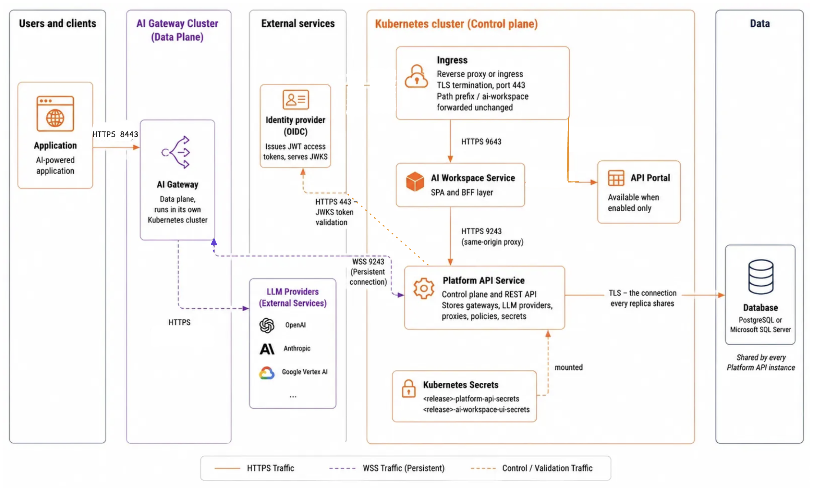

# Production deployment overview

This section is for platform engineers and site reliability engineers who run AI Workspace for an organization. It covers the two supported shapes: a Docker Compose stack on one or more virtual machines, and a Helm release on Kubernetes.

The section has two parts. The Production Readiness pages explain what each area of a production deployment requires and why, independent of where you run it. The deployment guides then apply it end to end, with the full configuration for one platform: [Deploy on VMs](deploy-on-vms.md), [Deploy on Kubernetes](deploy-on-kubernetes.md), and [Deploy on OpenShift](openshift.md).

!!! note "The database examples use PostgreSQL"
    Examples throughout this section use PostgreSQL, because it's the most common choice. The Platform API also supports Microsoft SQL Server, and the two are interchangeable everywhere this section says "the database". Set the driver and connection settings for the one you run, then follow the rest as written. For the accepted `driver` values and the per-database setup, see [Connect a database to the Platform API](../setting-up/database.md).

## What you deploy

A production deployment has three parts.

| Part | What it does | Where it runs |
|------|--------------|---------------|
| Platform API | The control plane. Stores gateways, large language model (LLM) providers, proxies, policies, and secrets, and serves the representational state transfer (REST) API. | Your cluster or VM |
| AI Workspace | The browser interface. A React single-page application served by a Go backend-for-frontend (BFF) that owns the user session. | Your cluster or VM |
| AI gateways | The data plane. Routes traffic between applications and LLM providers, and registers itself with the Platform API. | Anywhere your applications can reach |

The Platform API and AI Workspace form the control plane and are what this section deploys. Gateways connect to it afterward. See [Connect AI gateways in production](connect-gateways.md).

The distribution also ships the API Portal, a separate product that shares this same control plane. It's off by default, and you can add it later. See [Optional: add the API Portal](#optional-add-the-api-portal).

AI Workspace handles user interactions and communicates with the Platform API. The Platform API manages configuration and data, and validates user tokens through the identity provider. AI Gateways connect to the Platform API to register and receive configuration, then forward application requests to the configured LLM providers.

The following diagram shows that deployment architecture, with browsers and gateways on one side and the database and identity provider on the other:

## Choose a deployment shape

Both shapes run the same container images and read the same configuration keys. They differ in how you supply those keys and how you scale.

| | Virtual machine | Kubernetes |
|---|---|---|
| **What you run** | The Docker Compose stack from the release distribution, on a Linux host with a container runtime | The `ai-workspace` Helm chart, an umbrella chart with the `platform-api` and `ai-workspace-ui` component charts as dependencies |
| **Best for** | A fixed number of hosts, teams without a Kubernetes platform, air-gapped or tightly controlled networks | A cluster you already run, horizontal scaling, and rolling upgrades |
| **You supply configuration through** | `configs/config.toml`, plus the `api-platform.env` file that Compose loads | Your own values file, layered over the chart defaults with `-f` |
| **Scaling** | Several hosts behind a load balancer, all pointing at one database server | Replica counts and a PodDisruptionBudget, backed by a shared database server |
| **You operate** | The host, the container runtime, the reverse proxy, certificate renewal, and backups | The cluster, an ingress controller, cert-manager or your own certificate secrets, and backups |

For the details of each shape, including splitting the services across hosts on virtual machines, see [Deploy on VMs](deploy-on-vms.md#about-the-deployment) and [Deploy on Kubernetes](deploy-on-kubernetes.md#about-the-deployment). Red Hat OpenShift uses the Kubernetes shape, with OpenShift Routes in place of an Ingress. See [Deploy on OpenShift](openshift.md).

## Ports and traffic paths

The services listen on these ports by default. See [Change the ports AI Workspace uses](../setting-up/ports.md) to move them.

| Port | Service | Who connects to it |
|------|---------|--------------------|
| `9643` | AI Workspace HTTPS | Browsers, through your reverse proxy or ingress |
| `9243` | Platform API HTTPS | The AI Workspace BFF, and every AI gateway |
| `9543` | API Portal HTTPS | Browsers, only when you enable that component |

Both services also expose an optional plain-HTTP listener, off by default. Enable it only when a proxy in front of the service terminates TLS. See [Secure traffic with TLS](tls.md).

Health endpoints sit outside the path prefix so probes can reach a container directly:

| Endpoint | Service |
|----------|---------|
| `/healthz` | AI Workspace |
| `/health` | Platform API |

## What production requires that the quickstart doesn't

Neither service has a demo mode. Startup checks always run, and a missing requirement stops the process with a message naming what to supply. The quickstart satisfies those checks with values that `setup.sh` generates; production replaces each one.

| Requirement | Quickstart | Production |
|-------------|-----------|------------|
| At-rest encryption key | Generated by `setup.sh` | A managed 32-byte secret, stable across restarts and replicas |
| User login | File-based admin user | An OpenID Connect (OIDC) identity provider |
| TLS certificates | One self-signed pair | Certificates from your certificate authority (CA), or TLS terminated at a proxy |
| BFF to Platform API trust | The generated self-signed certificate | Your CA bundle, with certificate verification on |
| Database | SQLite file | PostgreSQL or SQL Server |

The deployment guides walk through all of it in order, from collecting hostnames to a connected gateway: [Deploy on VMs](deploy-on-vms.md), [Deploy on Kubernetes](deploy-on-kubernetes.md), and [Deploy on OpenShift](openshift.md). Start with the one for your platform. The Production Readiness pages go deeper on one topic each, and the guides link to them as they go:

- [Provision secrets and keys](secrets-and-keys.md)
- [Secure traffic with TLS](tls.md)
- [Expose AI Workspace](expose-the-workspace.md)
- [Run in high availability](high-availability.md)
- [Harden the deployment](harden.md)
- [Connect AI gateways in production](connect-gateways.md)
- [Operate the deployment](operate.md)

## Decide these before you install

Answering these up front avoids reinstalling. Each answer feeds a later page.

- **The public hostname** browsers use for AI Workspace, such as `workspace.example.com`. It goes into the identity provider redirect URLs, so changing it later means updating the provider too.
- **The address gateways use** to reach the Platform API, as `host:port`. It must resolve from the gateway's network, not from AI Workspace.
- **Where TLS terminates**, at the service listeners or at your reverse proxy or ingress.
- **Which database** you run, and who backs it up. A database server, rather than the default SQLite file, is the prerequisite for more than one Platform API replica.
- **Which identity provider** issues tokens, and whether it can mint the platform's `ap:*` scopes. If it can't, use role-based authorization instead.
- **Where secrets live**, in a mounted file, a Kubernetes Secret, or an external secret manager that syncs into one of those.

## Optional: add the API Portal

The API Portal is a separate product that shares this same Platform API control plane. It gives your API consumers a place to discover APIs and MCP servers, create applications, and manage subscriptions and API keys. It's off by default, and you can add it after AI Workspace is running without reinstalling anything.

On virtual machines, the distribution ships it as a Compose profile named `api-portal`. On Kubernetes, it ships as its own product chart, installed as a separate Helm release. For the steps, see [Deploy on VMs](deploy-on-vms.md#optional-add-the-api-portal) and [Deploy on Kubernetes](deploy-on-kubernetes.md#optional-add-the-api-portal). On OpenShift, see [Deploy the API Portal on OpenShift](../../../api-portal/1.0.0/deployment/openshift.md), which covers turning off its bundled Platform API.

Everything else about running the API Portal in production, including its database, its identity provider setup, and its configuration reference, is documented with the product itself. See the [API Portal overview](../../../api-portal/1.0.0/overview.md) and its [Setting Up](../../../api-portal/1.0.0/setting-up/database.md) section. The rest of this section covers AI Workspace only.

## Related

- [AI Workspace overview](../overview.md): what the product does and how the control plane and data plane divide
- [AI Workspace configuration and environment interpolation](../setting-up/configuration.md): how `config.toml` pulls values from the environment and from mounted files
- [Get started with AI Workspace](../getting-started.md): the local quickstart these defaults come from