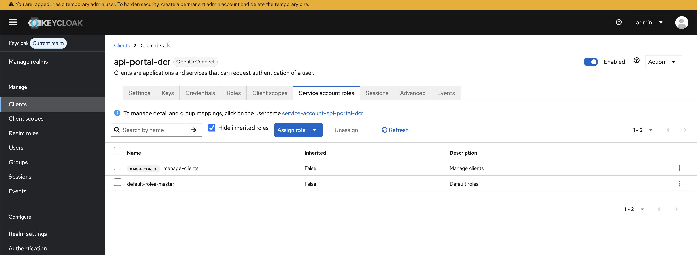
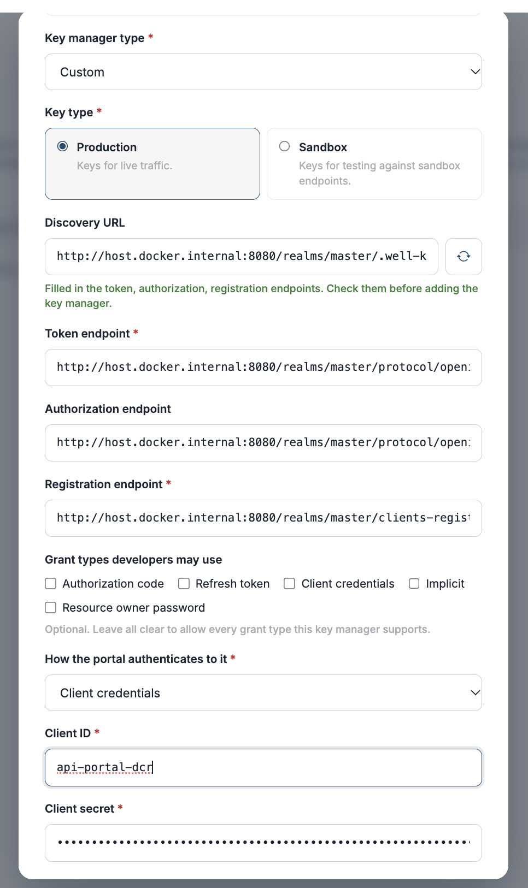

# Set up any DCR-compatible key manager

The **`custom`** key manager type connects the API Portal & MCP Hub to any authorization server that implements the Dynamic Client Registration specifications. It assumes nothing beyond them and sends no vendor-specific fields, so it works with servers that have no driver of their own in the portal.

Use it when your key manager implements:

- **[RFC 7591](https://datatracker.ietf.org/doc/html/rfc7591)** — Dynamic Client Registration, for creating OAuth2 applications.
- **[RFC 7592](https://datatracker.ietf.org/doc/html/rfc7592)** — the client configuration endpoint, for reading, updating and deleting them afterwards.

If your key manager is ThunderID, WSO2 Identity Server or Asgardeo, use the driver built for it instead — those handle behaviour the specifications leave open. See [Key manager types](key-manager-integration.md#key-manager-types).

## What the key manager has to provide

| Requirement | Why |
|---|---|
| A token endpoint accepting `client_credentials` | The portal authenticates itself before registering applications, and proxies developers' token requests here. |
| An RFC 7591 registration endpoint | `POST` with JSON client metadata, answering `200` or `201` with at least `client_id`. |
| An RFC 7592 configuration endpoint | `GET`, `PUT` and `DELETE` on an individual client, so keys can be read back, updated and deleted from the portal. |
| A credential for the portal itself | An OAuth2 client, Basic credentials or an API key that is allowed to call the registration endpoint. |

If the server registers applications but has no configuration endpoint, the portal can still create keys — but reading them back, editing and deleting them will fail.

!!! note "Registration access tokens"
    RFC 7592 servers return a `registration_access_token` and `registration_client_uri` with each registration, and the portal stores both (the token encrypted at rest). Some servers rotate the token on every update and reject the previous one immediately, so the portal writes back whatever each response returns. A server that issues no such token is also supported: the portal falls back to its own credential against `<registration_endpoint>/<client_id>`.

## Fields developers see

The `custom` driver offers the full RFC 7591 §2 client metadata set, so the form shows whatever your key manager actually supports:

`client_name`, `redirect_uris`, `grant_types`, `response_types`, `scope`, `token_endpoint_auth_method`, `jwks_uri`, `contacts`, `client_uri`, `logo_uri`, `tos_uri`, `policy_uri`, `software_id`, `software_version`

Only **Application name** and **Grant types** are required. **Callback URLs** are asked for only when the authorization code grant is selected, since a `client_credentials` application never redirects. Narrow what developers may pick with **Grant types developers may use** on the key manager.

---

## Worked example: Keycloak

Keycloak implements both specifications through its client-registration endpoint. The steps below were checked against **Keycloak 26.7.4**.

### 1. Find the endpoints

Every endpoint comes from the realm's OpenID Connect discovery document:

```
https://<keycloak-host>/realms/<realm>/.well-known/openid-configuration
```

| Endpoint | Path |
|---|---|
| Token | `https://<keycloak-host>/realms/<realm>/protocol/openid-connect/token` |
| Registration | `https://<keycloak-host>/realms/<realm>/clients-registrations/openid-connect` |
| Authorization | `https://<keycloak-host>/realms/<realm>/protocol/openid-connect/auth` |

You can paste the discovery URL into the portal and let it fill these in — see [step 3](#3-register-keycloak-in-the-portal).

### 2. Create the portal's client in Keycloak { #2-create-the-portals-client-in-keycloak }

This client is the portal's own credential, not a developer's.

1. In the Keycloak admin console, select your realm and go to **Clients** → **Create client**.
2. Set a **Client ID**, for example `api-portal-dcr`, and click **Next**.
3. Turn **Client authentication** on, and under **Authentication flow** enable **Service accounts roles**. Leave the interactive flows off — this client only uses `client_credentials`.
4. Save, then open the client's **Credentials** tab and copy the **Client secret**.
5. Open the **Service accounts roles** tab, click **Assign role**, filter by clients, and assign **`manage-clients`** from `realm-management`.

    

Confirm the credential works before moving on:

```bash
HOST=https://<keycloak-host>
REALM=<realm>

TOKEN=$(curl -s -X POST "$HOST/realms/$REALM/protocol/openid-connect/token" \
  -u "api-portal-dcr:$CLIENT_SECRET" \
  -H "Content-Type: application/x-www-form-urlencoded" \
  --data-urlencode "grant_type=client_credentials" \
  | jq -r .access_token)

curl -i -X POST "$HOST/realms/$REALM/clients-registrations/openid-connect" \
  -H "Authorization: Bearer $TOKEN" \
  -H "Content-Type: application/json" \
  -H "Accept: application/json" \
  -d '{
    "client_name": "Connectivity test",
    "grant_types": ["client_credentials"],
    "token_endpoint_auth_method": "client_secret_basic"
  }'
```

A `201` with `client_id`, `registration_client_uri` and `registration_access_token` in the body means the portal will be able to register applications. Remove the test client with the URI and token from that response:

```bash
curl -i -X DELETE "<registration_client_uri>" \
  -H "Authorization: Bearer <registration_access_token>"
```

### 3. Register Keycloak in the portal { #3-register-keycloak-in-the-portal }

!!! note "A local Keycloak over HTTP"
    A key manager added from the UI gets the deployment-wide posture in `[api_portal.key_manager_provisioning]`, which by default permits only `https` on a publicly resolvable address with a verified certificate. A Keycloak started on your own machine meets none of that, so set this **before starting the portal** — the section is read at startup:

    ```toml
    [api_portal.key_manager_provisioning]
    allow_private_endpoints = true
    insecure_skip_verify    = true
    allow_http_endpoints    = true
    ```

    `allow_http_endpoints` covers the `http://` scheme and `allow_private_endpoints` the loopback or private address. `insecure_skip_verify` does nothing for plain HTTP — include it only if you later put Keycloak behind a self-signed certificate. A key manager declared in the configuration file instead carries these flags on its own entry, and does not use this section.

    Development only. See [Endpoints added through the UI or the API](key-manager-integration.md#endpoints-added-through-the-ui-or-the-api).

#### From the UI

1. Go to **Settings** → **Key Managers** → **+ Add key manager**.
2. Set **OAuth2 applications** to **In the portal**.
3. Set **Key manager type** to **Custom**.
4. Paste the discovery URL into **Discovery URL** and click **Fetch**, or enter the three endpoints by hand.
5. Under **How the portal authenticates to it**, choose **Client credentials** and enter `api-portal-dcr` and its secret.
6. Choose a **Key type**, then click **Add key manager**.

<!-- TODO(screenshot): The Add key manager dialog with Custom selected and the Keycloak realm endpoints filled in. Save as en/docs/assets/img/devportal/key-managers/keycloak-add-key-manager.png -->


#### From the configuration file

```toml
[[api_portal.key_manager]]
id                     = "keycloak"
type                   = "custom"
name                   = "Keycloak"
description            = "Keycloak, <realm> realm"
token_endpoint         = "https://<keycloak-host>/realms/<realm>/protocol/openid-connect/token"
registration_endpoint  = "https://<keycloak-host>/realms/<realm>/clients-registrations/openid-connect"
authorize_endpoint     = "https://<keycloak-host>/realms/<realm>/protocol/openid-connect/auth"
key_type               = "PRODUCTION"

[api_portal.key_manager.auth]
method        = "client_credentials"
client_id     = "api-portal-dcr"
client_secret = '{{ env "APIP_AP_KEYCLOAK_CLIENT_SECRET" }}'
```

Restart the portal for the entry to take effect.

### Keycloak behaviour worth knowing

| Behaviour | What it means |
|---|---|
| **It rotates the registration access token on update** | A `PUT` returns a new token and refuses the previous one from that moment. The portal writes back the token from every response, so this is handled — but a script of your own talking to Keycloak directly must do the same. |
| **The client ID is a UUID** | The configuration URI is not derivable from the client name. The portal uses the `registration_client_uri` Keycloak returns, as RFC 7592 §3 requires. |
| **The portal's own credential also works at the configuration endpoint** | A key whose stored registration token was lost or rotated away is recoverable rather than stranded. |
| **An unknown client returns `404`** | The portal reports it as "client not found" rather than as a credential problem. |

---

## Troubleshooting

| Symptom | Likely cause |
|---|---|
| The portal refuses to start, naming the key manager entry | A required key is missing or `type` is not one of the registered drivers. The error names the entry and the field. |
| Saving the key manager is rejected with a blocked address range | The endpoint is private, loopback or link-local. See [Endpoints added through the UI or the API](key-manager-integration.md#endpoints-added-through-the-ui-or-the-api). |
| Saving is rejected because only `https` is permitted | A key manager added from the UI defaults to HTTPS-only. Either use `https`, or set `allow_http_endpoints` under `[api_portal.key_manager_provisioning]`. |
| Creating a key fails with a credential error | The portal's own client cannot reach the registration endpoint. Re-run the `curl` check in [step 2](#2-create-the-portals-client-in-keycloak). |
| Creating a key succeeds but reading it back fails | The key manager issued no registration access token and has no configuration endpoint at `<registration_endpoint>/<client_id>`. |