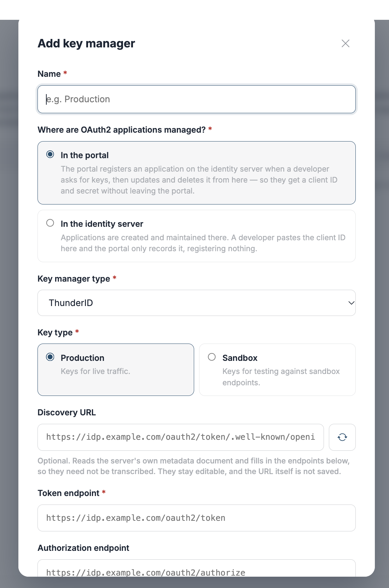

# Key managers

A **key manager** is the OAuth2 authorization server that issues access tokens for OAuth2-secured APIs. Registering one tells the API Portal & MCP Hub where to send token requests, and — when the key manager supports [Dynamic Client Registration](https://datatracker.ietf.org/doc/html/rfc7591) — lets the portal create OAuth2 applications on a developer's behalf.

## Two ways a developer gets keys

A key manager supports one of the following, chosen when you register it.

| Mode | What happens | When to use it |
|---|---|---|
| **The portal registers the application** | The developer fills in a short form and the portal registers a new OAuth2 client on the key manager over Dynamic Client Registration. The key manager returns a client ID and secret; the portal shows the secret **once** and never stores it. | The key manager implements RFC 7591, and you want developers to self-serve without an identity server console. |
| **The developer imports an existing client ID** | The developer creates the OAuth2 application in the key manager's own console, then pastes its client ID into the portal. No secret is stored. | The key manager has no DCR endpoint, or application creation is controlled by a separate team. |

!!! info "Key managers from an earlier release"
    Key managers registered in an earlier release use **The developer imports an existing client ID** mode. Nothing has to be migrated.

In both modes the portal never stores a client secret. When a developer requests a token, the portal proxies a `client_credentials` request to the key manager's token endpoint with the secret the developer supplies for that one call.

!!! note
    Deleting a key manager stops the applications that rely on it from obtaining new tokens through the portal. Tokens the key manager already issued stay valid until they expire. If you only need to take a key manager out of use temporarily, disable it instead.

## Setup guides

| Guide | What it covers |
|---|---|
| [Set up ThunderID as a key manager](key-manager-thunder.md) | Running ThunderID, registering the portal's own DCR client, and connecting the two from the UI or the configuration file. |
| [Set up any DCR-compatible key manager](key-manager-custom-dcr.md) | The generic `custom` driver for any server implementing RFC 7591 and RFC 7592, with Keycloak as a worked example. |

## Configuring from the UI

Key managers added here are stored in the portal's database and can be edited or removed without a restart.

1. Navigate to **Settings** and select the **Key Managers** tab under **ORGANIZATION**.
2. Click **+ Add key manager**.

    

3. Choose where OAuth2 applications are managed, then fill in the fields below.
4. Click **Add key manager**.

### Fields

Which fields the form shows depends on **OAuth2 applications**. Choosing *In the identity server* leaves only **Name**, **Discovery URL**, **Token endpoint** and **Key type** — everything else exists to register applications, so it is hidden.

| Field | Required | Description |
|---|---|---|
| **Name** | Yes | The name developers see when choosing where to create keys, for example `Production`. |
| **OAuth2 applications** | Yes | **In the portal** — the portal registers the application over DCR. **In the identity server** — developers create the application themselves and import its client ID. |
| **Discovery URL** | No | An OpenID Connect discovery document (`.../.well-known/openid-configuration`). Click **Fetch** to fill the token, registration and authorization endpoints from it rather than typing them. Shown when adding a key manager, not when editing one. |
| **Token endpoint** | Yes | Where the portal sends `client_credentials` token requests. Required in both modes — the portal dials it whichever way applications are created. |
| **Key type** | Yes | **Production** for live traffic, **Sandbox** for testing against sandbox endpoints. Every key created through this key manager inherits it. Fixed at creation — see the note below. |
| **Key manager type** | In the portal | The driver that speaks to this key manager. See [Key manager types](#key-manager-types). Not shown in the identity-server mode, which always uses the `provision` driver. |
| **Registration endpoint** | In the portal | The RFC 7591 client registration endpoint. |
| **Authorization endpoint** | No | The interactive authorization endpoint. A key manager issuing only `client_credentials` tokens has none. |
| **How the portal authenticates to it** | In the portal | The credential the portal presents when registering applications: **Client credentials**, **Basic**, or **API key**. The fields that follow change with this choice. |
| **Client ID** / **Client secret** | With client credentials | The portal's own OAuth2 client on this key manager — not a developer's. |
| **Scopes** | No | Scopes requested on the portal's token request, entered as chips. Needed when the key manager gates its registration endpoint behind specific scopes. |
| **Resource indicator** | No | An [RFC 8707](https://datatracker.ietf.org/doc/html/rfc8707) `resource` value, sent on the token request. Some key managers will not issue a token their registration endpoint accepts without it. |
| **Username** / **Password** | With basic | HTTP Basic credentials for the registration endpoint. |
| **API key** / **Header name** / **Scheme** | With API key | The key, the header it travels in (`Authorization` by default), and an optional scheme prefix such as `Bearer`. |
| **Grant types developers may use** | No | Narrows the grants offered on the developer's form. Leave empty to offer everything the driver supports. This is an administrative restriction, not a statement of what the key manager supports. |

Rows marked **In the portal** apply only when the portal registers applications.

!!! warning "Key type and key manager type are fixed at creation"
    Neither can be changed afterwards. Keys already issued were created as one kind, and relabelling the key manager cannot change what they are. To switch either, register a new key manager.

### Key manager types

| Type | Use for |
|---|---|
| `thunderid` | ThunderID. A short property list tuned to that key manager — see [Set up ThunderID](key-manager-thunder.md). |
| `wso2is` | WSO2 Identity Server, using its DCR v1.1 API. |
| `asgardeo` | Asgardeo. |
| `custom` | Any key manager implementing RFC 7591 and RFC 7592, with no driver of its own — see [Set up any DCR-compatible key manager](key-manager-custom-dcr.md). |
| `provision` | No registration at all: developers import a client ID they created elsewhere. |

## Configuring from the configuration file

A key manager declared in the portal's `config.toml` is read at startup. It cannot be edited or deleted from the UI, which makes it the right choice when the configuration belongs with the deployment rather than with an administrator.

Declare each one as a `[[api_portal.key_manager]]` array entry — double brackets, one block per key manager:

```toml
[[api_portal.key_manager]]
id                     = "thunder"
type                   = "thunderid"
name                   = "Production"
description            = "ThunderID, production realm"
token_endpoint         = "https://idp.example.com/oauth2/token"
registration_endpoint  = "https://idp.example.com/oauth2/dcr/register"
authorize_endpoint     = "https://idp.example.com/oauth2/authorize"
key_type               = "PRODUCTION"

[api_portal.key_manager.auth]
method        = "client_credentials"
client_id     = "portal-dcr-client"
client_secret = '{{ env "APIP_AP_KM_CLIENT_SECRET" }}'
scopes        = ["internal_application_mgt_create", "internal_application_mgt_view"]
```

An invalid entry stops the portal from starting rather than being skipped, so a typo surfaces at deploy time instead of the first time a developer asks for keys.

### `[[api_portal.key_manager]]`

| Key | Required | Default | Description |
|---|---|---|---|
| `id` | Yes | — | Stable identifier used in URLs and logs. Letters, digits, `.`, `_` and `-`, starting with a letter or digit. |
| `type` | Yes | — | One of `thunderid`, `wso2is`, `asgardeo`, `custom`, `provision`. |
| `name` | Yes | — | The display name developers see. |
| `description` | No | empty | Shown with the name in the portal. |
| `token_endpoint` | Yes | — | Where `client_credentials` token requests are sent. |
| `registration_endpoint` | Yes | — | The RFC 7591 client registration endpoint. Unlike the UI, a configuration entry requires it for every `type`, including `provision` — the portal refuses to start without it. |
| `authorize_endpoint` | No | empty | The interactive authorization endpoint, when the key manager has one. |
| `key_type` | No | `PRODUCTION` | `PRODUCTION` or `SANDBOX`. A value that is neither stops startup rather than defaulting, so `SANDBX` cannot quietly mean production. |
| `allow_http_endpoints` | No | `true` | Permit plain `http://` endpoints for this key manager. |
| `allow_private_endpoints` | No | `false` | Permit a private, loopback or otherwise internal address for this key manager. |
| `insecure_skip_verify` | No | `false` | Skip TLS certificate verification for every call to this key manager. Development only. |

### `[api_portal.key_manager.auth]`

Required on every entry — the portal needs a credential to register applications. `method` selects which of the remaining keys apply.

| Key | Applies to | Required | Default | Description |
|---|---|---|---|---|
| `method` | all | Yes | — | `client_credentials`, `basic` or `api_key`. |
| `client_id` | `client_credentials` | Yes | — | The portal's own client on this key manager. |
| `client_secret` | `client_credentials` | Yes | — | Its secret. Reference an environment variable with `{{ env "NAME" }}` rather than writing the value into the file. `{{ file "/path" }}` reads it from disk instead, but the path must sit inside the directories named by `APIP_CONFIG_FILE_SOURCE_ALLOWLIST` or the portal refuses to start. |
| `token_endpoint` | `client_credentials` | No | the key manager's `token_endpoint` | Only set this when the portal's own token endpoint differs from the one developers use. |
| `scopes` | `client_credentials` | No | none | Array of scopes requested on the portal's token request. |
| `resource` | `client_credentials` | No | empty | RFC 8707 resource indicator, sent as `resource` on the token request. |
| `send_credentials_in_body` | `client_credentials` | No | `false` | `true` sends `client_id`/`client_secret` in the form body (`client_secret_post`) instead of the Basic header. |
| `username`, `password` | `basic` | Yes | — | HTTP Basic credentials. |
| `api_key` | `api_key` | Yes | — | The key value. |
| `header_name` | `api_key` | No | `Authorization` | The header the key travels in. |
| `scheme` | `api_key` | No | empty | A prefix such as `Bearer`, kept separate from the key so rotating the key leaves it alone. |

### Endpoints added through the UI or the API

Key managers created from the UI are written by an administrator at runtime rather than by whoever deploys the portal, so they do not carry their own address flags. One deployment-wide section governs all of them:

```toml
[api_portal.key_manager_provisioning]
allow_http_endpoints    = false
allow_private_endpoints = false
insecure_skip_verify    = false
```

| Key | Default | Description |
|---|---|---|
| `allow_http_endpoints` | `false` | Permit plain `http://` endpoints on key managers created through the UI or the Management API. |
| `allow_private_endpoints` | `false` | Permit private, loopback and internal addresses on those key managers. |
| `insecure_skip_verify` | `false` | Skip TLS verification for them. Development only. |

All three default off, so a key manager added from the UI must use `https` on a publicly resolvable address until an operator says otherwise. Link-local and cloud metadata addresses are refused whatever these are set to.

!!! tip "A development portal pointing at a local identity server"
    `http://localhost:8090/...` fails both the scheme check and the address check, so a local setup normally needs `allow_http_endpoints` **and** `allow_private_endpoints` set to `true`. A key manager declared in `config.toml` already permits `http` by default and needs only `allow_private_endpoints` on its own entry.

## Editing and removing a key manager

Click a key manager's name, or the pencil icon, to edit it. The name, endpoints and credentials can be changed; the key manager type and key type cannot.

Click the trash icon to delete it. A key manager that still has keys issued against it cannot be deleted or renamed until those keys are removed.

## How developers use key managers

1. The developer opens **OAuth2 Keys** and chooses a key manager.
2. If the key manager registers applications, they fill in the application details and the portal creates the OAuth2 client. The client secret is shown once, at creation — the portal does not store it and cannot show it again.
3. If the key manager expects an existing application, they paste the client ID of an application they created in the key manager's own console.
4. To obtain a token, the developer supplies the client secret and the portal proxies a `client_credentials` request to the token endpoint. The secret is used for that one call and is never stored.

A key the portal registered can also be updated or deleted from the portal, and both are forwarded to the key manager — deleting the key removes the OAuth2 application itself. An imported key is only unlinked: the application stays in the key manager, where it is owned and managed.