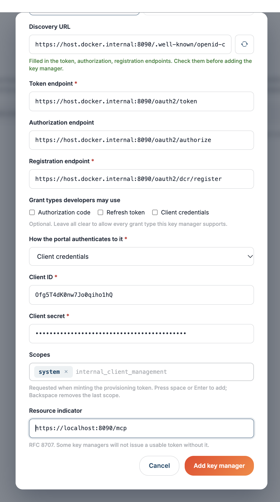

# Set up ThunderID as a key manager

ThunderID speaks [RFC 7591](https://datatracker.ietf.org/doc/html/rfc7591) Dynamic Client Registration with [RFC 7592](https://datatracker.ietf.org/doc/html/rfc7592) read, update and delete, so the API Portal & MCP Hub can create OAuth2 applications on a developer's behalf and manage them afterwards.

This page covers what ThunderID needs, then how to register it in the portal — from the UI or from the configuration file.

## Before you begin

You need a running ThunderID instance reachable from the portal, and an OAuth2 application **in ThunderID for the portal itself**. That application is not a developer's: it is the credential the portal presents when registering theirs, so it needs permission to call ThunderID's DCR endpoint.

### Create the portal's application in ThunderID

1. Log in to ThunderID.
2. Go to **Applications** and click **Add Application**.
3. Select the **Backend Service** type and create one with a name.
4. **Copy the secret now.** It is shown once and cannot be retrieved later.
5. The **Overview** page has the client ID and the well-known (discovery) URL. Keep both — the portal needs the client ID, and the discovery URL saves typing the endpoints by hand.

### Authorize it to call the DCR endpoint

A newly created application can obtain a token but cannot register clients with it until it holds a role that permits this.

6. Go to the **Roles** tab and choose **Edit**.
7. Open the **Assignment** tab, then the **Apps** tab inside it.
8. Click **Add** and select the application you created.

!!! note
    These steps use the **administrator** role for simplicity. A custom role works too — it needs the `system` permission to reach the DCR endpoint.

### Endpoints

ThunderID exposes the three endpoints the portal needs under its OAuth2 base path:

| Endpoint | Path | Used for |
|---|---|---|
| Token | `https://<thunder-host>/oauth2/token` | The portal's own token, and developers' `client_credentials` token requests. |
| Registration | `https://<thunder-host>/oauth2/dcr/register` | Creating, reading, updating and deleting developers' OAuth2 applications. |
| Authorization | `https://<thunder-host>/oauth2/authorize` | Only needed if developers use the authorization code grant. |

Rather than typing these, paste the well-known URL from the application's Overview page into **Discovery URL** in the portal and click **Fetch**.

### Check the credential works

Before registering ThunderID in the portal, confirm the application can reach the DCR endpoint. First get a token:

```bash
PORTAL_CLIENT_ID=<client id from the Overview page>
PORTAL_CLIENT_SECRET=<the secret copied at step 4>
HOST=https://<thunder-host>

TOKEN=$(curl -s -k -X POST "$HOST/oauth2/token" \
  -u "$PORTAL_CLIENT_ID:$PORTAL_CLIENT_SECRET" \
  --data-urlencode "grant_type=client_credentials" \
  --data-urlencode "scope=system" \
  --data-urlencode "resource=$HOST/mcp" \
  | jq -r .access_token)
```

Then register a throwaway client with it:

```bash
curl -i -k -X POST "$HOST/oauth2/dcr/register" \
  -H "Authorization: Bearer $TOKEN" \
  -H "Content-Type: application/json" \
  -H "Accept: application/json" \
  -d '{
    "client_name": "Connectivity test",
    "grant_types": ["client_credentials"],
    "token_endpoint_auth_method": "client_secret_basic"
  }'
```

A `200` or `201` carrying a `client_id` means the portal will be able to register applications. Delete the test client afterwards, using the `client_id` from that response:

```bash
curl -i -k -X DELETE "$HOST/oauth2/dcr/register/<client_id>" \
  -H "Authorization: Bearer $TOKEN"
```

!!! note
    `-k` skips TLS certificate verification, which a ThunderID instance on `localhost` with a self-signed certificate needs. Drop it against an instance with a certificate your machine trusts.

!!! tip "Reading a failure"
    If the token request fails, the response body names which input is wrong — `invalid_client` points at the credential, `invalid_scope` at `scope`, and `invalid_target` at `resource`. A status code alone cannot tell those apart. A token that is issued but rejected at the DCR endpoint usually means the application has not been assigned a role yet.

## Configuring from the UI

Use this when administrators should be able to add and change the key manager without a restart.

### Prepare the portal first

A key manager added from the UI gets the deployment-wide posture in `[api_portal.key_manager_provisioning]`, which defaults to HTTPS-only on a publicly resolvable address with a verified certificate. A development ThunderID meets none of those, so relax all three **before starting the portal** — this section is read at startup:

```toml
[api_portal.key_manager_provisioning]
allow_private_endpoints = true
insecure_skip_verify    = true
allow_http_endpoints    = true
```

| Flag | Needed because |
|---|---|
| `allow_private_endpoints` | ThunderID is on a private or loopback address. |
| `insecure_skip_verify` | Its certificate is self-signed. |
| `allow_http_endpoints` | Only if ThunderID is served over plain `http`. |

!!! warning
    These relax checks that exist to stop the portal being pointed somewhere it should not reach. Development only — see [Endpoints added through the UI or the API](key-manager-integration.md#endpoints-added-through-the-ui-or-the-api).

### Add the key manager

1. Navigate to **Settings** and select the **Key Managers** tab under **ORGANIZATION**.
2. Click **+ Add key manager**.
3. Set **OAuth2 applications** to **In the portal**, so the portal registers applications over DCR.
4. Set **Key manager type** to **ThunderID**.
5. Paste the well-known URL from the application's Overview page into **Discovery URL** and click **Fetch** to populate the token, registration and authorization endpoints.

    

6. Under **How the portal authenticates to it**, choose **Client credentials** and enter the client ID and secret of the portal's own ThunderID application.
7. Enter the **Scopes** and **Resource indicator** ThunderID's token endpoint requires — see the table below.
8. Choose a **Key type** — **Production** or **Sandbox**. This cannot be changed later.
9. Click **Add key manager**.

| Field | Value for ThunderID |
|---|---|
| **Key manager type** | ThunderID |
| **OAuth2 applications** | In the portal |
| **Token endpoint** | `https://<thunder-host>/oauth2/token` |
| **Registration endpoint** | `https://<thunder-host>/oauth2/dcr/register` |
| **Authorization endpoint** | `https://<thunder-host>/oauth2/authorize`, if developers use the authorization code grant |
| **How the portal authenticates to it** | Client credentials |
| **Client ID** / **Client secret** | The portal's own ThunderID application |
| **Scopes** | `system` |
| **Resource indicator** | `https://localhost:8090/mcp` — the resource server the `system` scope is registered against. This is ThunderID's default; if yours differs, use the resource server URL that scope is registered against instead. |

!!! warning "Do not rewrite the resource indicator for Docker"
    The **Resource indicator** is an identifier that ThunderID matches against its registered resource server — the portal never dials it. Leave it exactly as ThunderID has it registered, even when the endpoints above use a different host. The endpoints are dialled; this is not.

### When the portal runs in Docker

A portal running in a container resolves `localhost` to **the container**, not to the machine ThunderID is on. Pasting `https://localhost:8090/.well-known/openid-configuration` fails with *"The discovery document could not be read from that URL"*, and the log shows the real reason:

```
Key manager discovery fetch failed {"error":"connect ECONNREFUSED ::1:8090; connect ECONNREFUSED 127.0.0.1:8090"}
```

Use the host's address from the container's point of view. On Docker Desktop that is `host.docker.internal`:

```
https://host.docker.internal:8090/.well-known/openid-configuration
```

**Fetch rewrites nothing.** The discovery document ThunderID returns still names `localhost`, so after clicking **Fetch** change the host in the populated **Token endpoint**, **Registration endpoint** and **Authorization endpoint** as well — otherwise discovery succeeds and every later call still fails. Leave the **Resource indicator** alone, per the warning above.

On Linux, `host.docker.internal` is not provided by default: add `extra_hosts: ["host.docker.internal:host-gateway"]` to the portal's service, or run ThunderID on the same Docker network and use its service name.

## Configuring from the configuration file

Use this when the key manager belongs with the deployment rather than with an administrator. An entry declared here is read at startup and cannot be edited or deleted from the UI.

```toml
[[api_portal.key_manager]]
id                     = "thunder"
type                   = "thunderid"
name                   = "Production"
description            = "ThunderID"
token_endpoint         = "https://<thunder-host>/oauth2/token"
registration_endpoint  = "https://<thunder-host>/oauth2/dcr/register"
authorize_endpoint     = "https://<thunder-host>/oauth2/authorize"
key_type               = "PRODUCTION"

[api_portal.key_manager.auth]
method        = "client_credentials"
client_id     = "<client id from the Overview page>"
client_secret = '{{ env "APIP_AP_THUNDER_CLIENT_SECRET" }}'
scopes        = ["system"]
resource      = "https://<thunder-host>/mcp"
```

`scopes` and `resource` are what ThunderID's token endpoint expects for a token its DCR endpoint will accept — the same two values as the `curl` check above. Restart the portal for the entry to take effect. If anything in it is invalid, the portal refuses to start and names the problem, rather than starting without the key manager.

### Pointing a development portal at a local ThunderID

A key manager declared here carries its own flags, rather than the deployment-wide `[api_portal.key_manager_provisioning]` section the UI route uses. A local ThunderID needs two of them: its address is private, and its certificate is self-signed.

```toml
[[api_portal.key_manager]]
id                      = "thunder-local"
type                    = "thunderid"
name                    = "Local ThunderID"
token_endpoint          = "https://host.docker.internal:8090/oauth2/token"
registration_endpoint   = "https://host.docker.internal:8090/oauth2/dcr/register"
authorize_endpoint      = "https://host.docker.internal:8090/oauth2/authorize"
allow_private_endpoints = true
insecure_skip_verify    = true

[api_portal.key_manager.auth]
method        = "client_credentials"
client_id     = "<client id from the Overview page>"
client_secret = '{{ env "APIP_AP_THUNDER_CLIENT_SECRET" }}'
scopes        = ["system"]
resource      = "https://localhost:8090/mcp"
```

The `client_secret` above reads an environment variable rather than holding the value, so the variable has to reach the portal process. When the portal runs under Docker Compose, add it to the `environment:` block of the `api-portal` service in `docker-compose.yaml`:

```yaml
  api-portal:
    environment:
      APIP_AP_SERVER_PORT: ${APIP_AP_SERVER_PORT:-9543}
      APIP_AP_THUNDER_CLIENT_SECRET: <the secret copied at step 4>
```

Prefer `${APIP_AP_THUNDER_CLIENT_SECRET}` here and keep the value in the `api-platform.env` file the service already loads, so the secret is not committed with the Compose file. Recreate the container afterwards — `docker compose up -d api-portal` — since a running container does not pick up a changed environment.

!!! note
    `{{ env "NAME" }}` fails closed: if the variable is unset or empty the portal refuses to start and names it, rather than starting with an unusable key manager.

`allow_http_endpoints` is not listed because a configuration entry already permits `http` by default — add it only to be explicit. It is the UI route that needs it set, since the provisioning section defaults it off.

If the portal runs in a container, replace `localhost` in `token_endpoint` and `registration_endpoint` with `host.docker.internal` — but leave `resource` as the URL ThunderID registered the `system` scope against, since it is an identifier rather than an address the portal dials.

!!! warning
    `allow_private_endpoints` and `insecure_skip_verify` relax checks that exist to stop the portal being pointed at something it should not reach. Use them for local development only.

## What developers see

With ThunderID registered, a developer opening **OAuth2 Keys** and choosing this key manager is asked for:

| Field | Required | Notes |
|---|---|---|
| **Application name** | Yes | Shown to end users on the consent screen. |
| **Grant types** | Yes | Authorization code, refresh token, or client credentials. You can narrow this list per key manager with **Grant types developers may use**. |
| **Callback URLs** | Only with authorization code | Absolute URIs, no fragment. A `client_credentials` application never redirects and is not asked for one. |
| **Response types** | No | `code`, `token` or `id_token`. Must match the selected grants. |
| **Client authentication method** | No | `client_secret_basic`, `client_secret_post`, or `none` for a public client. |

The portal creates the client in ThunderID and shows the client secret **once**. It is not stored and cannot be shown again — the developer supplies it per token request.