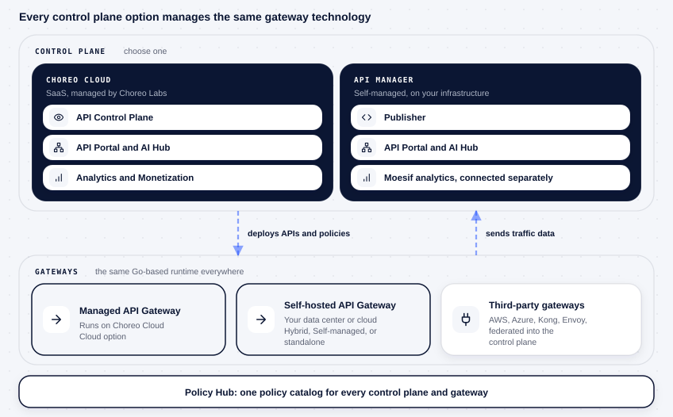
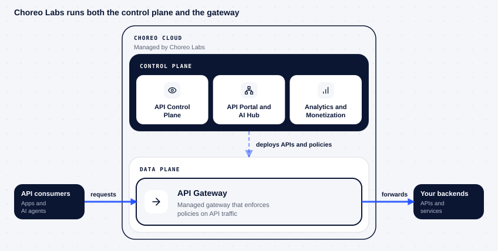
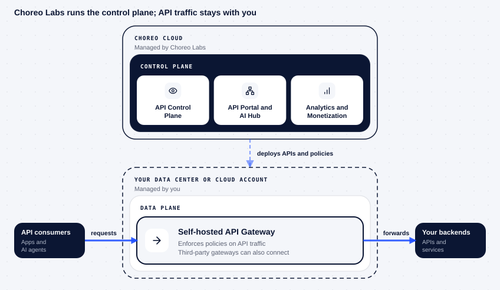
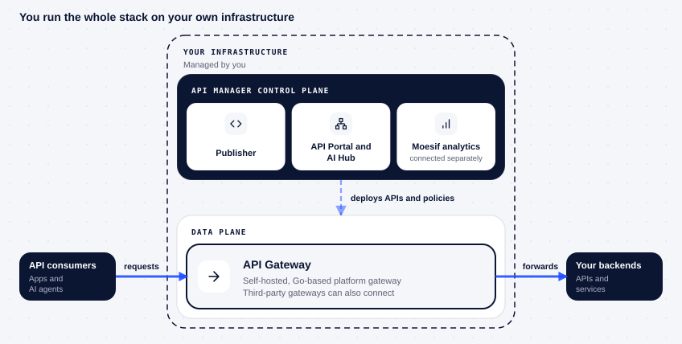
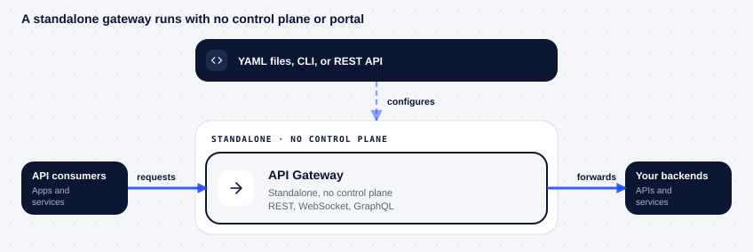

# What is API Management?

Choreo API Management helps you design, secure, publish, and govern your APIs. Proxy REST, WebSocket, and GraphQL APIs, apply policies, and expose APIs to developers through a portal.

Choreo API Management is offered three ways: as SaaS on Choreo Cloud, as a hybrid deployment with the control plane on Choreo Cloud and gateways in your own infrastructure, or fully self-managed with API Manager.

This page explains what Choreo API Management offers and helps you choose the right path. To govern LLM, MCP, or agent traffic, see [Agent Management](https://choreolabs.com/documentation/agent-management/).

Choreo Labs manages the Choreo Cloud control plane and the managed API Gateway. Whichever control plane you choose, it deploys APIs and policies to the same gateway runtime.

## What are you looking for?

There are two starting points:

- **A full platform for managing your APIs.** Use a web console to create APIs, apply policies, set up a developer portal, manage subscriptions, and monitor traffic. The platform handles the full API lifecycle: design, deploy, test, govern, and monetize. Choose who runs the infrastructure: Cloud, Hybrid, or Self-managed.
- **Only an API gateway.** Run a lightweight gateway that you configure with YAML files, the CLI, or REST APIs, with no web UI, control plane, or portal. See [Standalone API Gateway](#standalone-api-gateway).

### Option A: Cloud

Choreo Labs hosts everything on Choreo Cloud.

This is the fastest way to get started. Choreo Labs manages the control plane, where you design and manage APIs, and the data plane, where gateways process traffic. Sign up and start creating APIs within minutes, with no infrastructure to manage.

**Best for:** startups, mid-market companies, and teams that want to ship fast without managing infrastructure.

**What's included:** API Control Plane, API Portal and AI Hub, Moesif analytics, and the API Gateway, all managed by Choreo Labs.

[Choreo Cloud documentation](https://choreolabs.com/documentation/api-management/cloud/get-started/)

### Option B: Hybrid

Choreo Labs hosts the control plane; you host the gateways.

You get a cloud-managed control plane, the UI where you design and govern APIs, while the gateways run in your own data center or cloud account. API traffic never leaves infrastructure you manage, which satisfies most data residency requirements.

**Best for:** mid-market and enterprise customers who need governance with data privacy, and organizations that want managed convenience but cannot route traffic through third-party infrastructure.

**What's included:** a cloud control plane (API Control Plane, API Portal and AI Hub, Moesif analytics) managed by Choreo Labs, plus self-hosted API Gateways in your environment. You can also federate third-party gateways (AWS, Azure, Kong, Envoy) under the same control plane.

See [Set up hybrid deployment](https://choreolabs.com/documentation/api-management/cloud/api-gateway/self-hosted-gateways/quickstart-guide/).

### Option C: Self-managed (API Manager)

You host everything.

With API Manager, you download and run the entire stack on your own infrastructure: control plane, gateways, portal, and everything else. You have full control over where your software and data reside, on an open source foundation built for customization.

It bundles platform components into a versioned release; for example, API Manager 4.7 includes API Gateway 1.6 and Control Plane 1.9. From version 4.7, API Manager uses the same Go-based gateway runtime as the Cloud and Hybrid options.

**Best for:** enterprises with strict data residency requirements, government agencies, regulated industries, air-gapped environments, and organizations that need complete control of their infrastructure.

**What's included:** a self-hosted control plane (Publisher and API Portal and AI Hub) and self-hosted API Gateways. Moesif analytics can be connected separately, and third-party gateways can be federated.

See [API Manager documentation](https://choreolabs.com/documentation/api-management/self-hosted/api-manager/overview/).

## How do the three options compare?

| Feature | Cloud | Hybrid | Self-managed (API Manager) |
|:--------|:------|:-------|:---------------------------|
| Control plane | Managed by Choreo Labs | Managed by Choreo Labs | Managed by you |
| Gateways | Managed by Choreo Labs | Managed by you | Managed by you |
| API traffic stays in your infrastructure | No | Yes | Yes |
| Setup complexity | Minimal | Moderate | High |
| Web UI for managing APIs | Yes | Yes | Yes |
| API Portal and AI Hub | Included | Included | Included |
| Third-party gateway federation | Yes | Yes | Yes |
| Air-gapped or fully offline | No | No | Yes |

All three options use the same gateway technology. You can start with Cloud and move to Hybrid or Self-managed later without rearchitecting.

### Can I self-host only the components I need?

Yes. Instead of the full API Manager stack, you can run the **API Portal and AI Hub** on its own and connect it to your self-hosted gateways. Consumers use it to discover APIs and MCP servers, create applications, and manage subscriptions and keys. See the [self-hosted API Portal and AI Hub documentation](https://choreolabs.com/documentation/api-management/api-portal/latest/).

To self-host a control plane for AI gateways, use the Agent Control Plane in Agent Management.

## Standalone API Gateway

If you don't need a management console and want a high-performance gateway you configure with YAML files, the CLI, or REST APIs, use the standalone API Gateway. There is no web UI, control plane, or portal: you download a lightweight binary and run it.

The API Gateway handles traditional API traffic, including REST, WebSocket, and GraphQL. Apply authentication, rate limiting, request and response transformations, and custom policies, all configured through YAML files and CLI commands.

See [API Gateway documentation](https://choreolabs.com/documentation/api-management/api-gateway/latest/quick-start-guide/).

For a standalone gateway for LLM and MCP traffic, see the AI Gateway in Agent Management.

## What is the difference between standalone mode and platform mode?

The API Gateway runs either inside the platform (Cloud, Hybrid, or API Manager) or standalone. These are not different products: it is the same Go-based gateway with the same policy engine. Only how you configure it changes.

|  | Inside the platform | Standalone |
|:--|:--------------------|:-----------|
| How you configure it | Platform web UI or configuration files | YAML files, CLI, REST API |
| Control plane | Manage APIs, policies, subscriptions, and lifecycle visually | None. You manage everything in configuration files |
| API Portal and AI Hub | Developers discover and subscribe to your APIs | None |
| Analytics and monetization | Available, through Moesif | Basic observability (logs, traces) |
| Best for | Teams managing many APIs across the organization | Individual developers or small teams that want a lightweight gateway |

A common adoption path is to start with a standalone gateway and connect it to a control plane later. Attach it to the Choreo Cloud control plane to make it a hybrid gateway, or to the API Manager control plane for self-managed governance.

## Platform components

The platform has control plane components, where you manage APIs, and gateway components, where API traffic runs.

### Control plane components

| Component | What it does | Docs |
|:----------|:-------------|:-----|
| API Control Plane | Design, publish, version, and govern APIs through the web UI and configuration files. Enforce policies across all connected gateways. | Part of Cloud and API Manager |
| API Portal and AI Hub | Developer-facing portal for API discovery, subscriptions, SDK generation, and theming. Includes agentic consumption for AI agents, such as the `llms.txt` endpoint, MCP registry, and Arazzo workflow support. Available in Cloud and as a self-hosted portal. | [Cloud docs](https://choreolabs.com/documentation/api-management/cloud/api-portal/overview/), [self-hosted docs](https://choreolabs.com/documentation/api-management/api-portal/latest/) |
| Analytics and Monetization | Traffic monitoring, runtime and audit logs, usage tracking, and usage-based billing. Powered by Moesif. | Analytics docs |

### Gateway components

| Component | What it does | Docs |
|:----------|:-------------|:-----|
| API Gateway | High-performance, Go-based gateway for REST, WebSocket, and GraphQL traffic. Handles authentication, rate limiting, transformations, and custom policies. | Standalone docs, [cloud-integrated docs](https://choreolabs.com/documentation/api-management/cloud/api-gateway/overview/) |
| Third-party gateways | Federate existing gateways (AWS, Azure, Kong, and Envoy) without replacing them. Catalog their APIs alongside your managed APIs in one portal, observe all gateways together, and, for supported gateways, deploy API configurations from the control plane. | Federation docs |

## Choose your path

| I want to… | Start here |
|:-----------|:-----------|
| Get up and running fast with a managed cloud platform | [Cloud](https://choreolabs.com/documentation/api-management/cloud/get-started/) |
| Use a cloud control plane but keep API traffic in my infrastructure | [Hybrid setup](https://choreolabs.com/documentation/api-management/cloud/api-gateway/self-hosted-gateways/quickstart-guide/) |
| Run everything on my own infrastructure with a UI | [API Manager](https://choreolabs.com/documentation/api-management/self-hosted/api-manager/overview/) |
| Run a lightweight API gateway with no UI | [API Gateway](https://choreolabs.com/documentation/api-management/api-gateway/latest/quick-start-guide/) |
| Set up a portal for API discovery | [API Portal and AI Hub](https://choreolabs.com/documentation/api-management/cloud/api-portal/overview/) |
| Run a self-hosted portal | [Self-hosted API Portal and AI Hub](https://choreolabs.com/documentation/api-management/api-portal/latest/) |
| Find or write API policies | [Policy Hub](https://choreolabs.com/documentation/api-management/cloud/policy-hub/overview/) |
| Monitor traffic and monetize my APIs | Analytics and Monetization |
| Follow end-to-end scenario walkthroughs | Guides |
| Govern LLM, MCP, or agent traffic | [Agent Management](https://choreolabs.com/documentation/agent-management/) |

## Key concepts

These concepts apply across the platform:

- [**Organizations:**](https://choreolabs.com/documentation/api-management/cloud/key-concepts/#organizations) the top-level boundary for your platform instance. All APIs, users, and configurations belong to an organization.
- [**Projects:**](https://choreolabs.com/documentation/api-management/cloud/key-concepts/#projects) logical groupings of APIs and services within an organization. Use them to separate teams, environments, or business domains.
- [**Data planes:**](https://choreolabs.com/documentation/api-management/cloud/key-concepts/#control-plane-and-data-planes) the gateway runtime environments where APIs are deployed and traffic is processed. A data plane can be managed by Choreo Labs (Cloud), self-hosted (Hybrid or Self-managed), or a federated third-party gateway.
